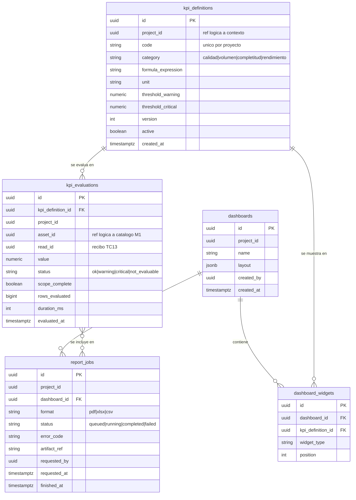

# M4 Analítica — Diseño (Sprint 0, P26)

**Módulo:** 4 (Analítica) · **Paquete base:** `org.dataanaliticsent.analitica` · **Estado:** borrador para revisión
**Alcance:** especificación de KPIs, modelo conceptual de datos analíticos y flujos. Los datos de este documento son sintéticos; el dataset `E-Commerce Retail Baseline` no está materializado en el repositorio, por lo que **ningún valor de este diseño proviene de datos empresariales reales**.

## 1. Principios

- M4 es un módulo del monolito: consume otros módulos mediante interfaces y DTO públicos, no repositorios internos compartidos.
- M4 **no accede directamente a las fuentes empresariales**. Obtiene contenido mediante el contrato TC13 (lecturas con recibo) y metadatos mediante el catálogo de M1.
- Toda ruta de M4 está bajo sesión autenticada y RBAC por proyecto (`/api/v1/projects/{projectId}/analytics/...`). La excepción propuesta es `/api/v1/analitica/ping`, que en el backend actual también exige sesión salvo decisión del tronco común.
- Un resultado derivado de una lectura parcial se marca como parcial y no se presenta como evaluación final.

## 2. Especificación de KPIs de negocio

Los umbrales son valores iniciales propuestos y deben ser confirmados por el negocio.

| Código | Categoría | Definición | Fórmula | Unidad | Umbral inicial (propuesto) |
| --- | --- | --- | --- | --- | --- |
| `DQ_VALIDEZ` | Calidad de datos | Proporción de filas que cumplen las reglas de validez del activo | `filas_validas / filas_evaluadas` | ratio 0–1 | ≥ 0.98 |
| `DQ_UNICIDAD` | Calidad de datos | Proporción de filas sin duplicados sobre la clave declarada | `filas_unicas / filas_evaluadas` | ratio 0–1 | ≥ 0.99 |
| `VOL_FILAS` | Volumen | Número de filas leídas del activo en la ventana evaluada | `count(filas)` | filas | informativo |
| `VOL_VARIACION` | Volumen | Variación respecto a la evaluación anterior comparable | `(vol_actual - vol_previo) / vol_previo` | ratio | ±0.20 |
| `COMP_COLUMNA` | Completitud | Proporción de valores no nulos por columna | `no_nulos / filas_evaluadas` | ratio 0–1 | ≥ 0.95 |
| `COMP_ACTIVO` | Completitud | Promedio ponderado de `COMP_COLUMNA` de las columnas obligatorias | `Σ(comp_i · w_i) / Σ w_i` | ratio 0–1 | ≥ 0.95 |
| `PERF_LATENCIA_LECTURA` | Rendimiento | Tiempo total de la lectura TC13 más el cálculo del KPI | `t_fin - t_inicio` | ms | p95 ≤ 5000 |
| `PERF_THROUGHPUT` | Rendimiento | Filas procesadas por segundo | `filas_evaluadas / duracion_s` | filas/s | informativo |

Reglas comunes:

- Cada evaluación registra `scope.complete` heredado de la lectura TC13. Si es `false`, el estado del resultado es `partial`.
- El estado de un KPI es `ok`, `warning` (fuera de umbral dentro de tolerancia), `critical` (fuera de tolerancia) o `not_evaluable` (sin datos o columnas faltantes).
- Un KPI sin filas (`filas_evaluadas = 0`) devuelve `not_evaluable`, nunca `0` ni `1`.

## 3. Modelo conceptual de datos analíticos

Esquema lógico propuesto: `analitica`. **No existe aún una migración Flyway** que lo cree; este diseño no autoriza crear tablas sin revisión del tronco común. Las claves foráneas a `contexto` y `catalogo` se declaran como referencias lógicas (UUID) para no acoplar esquemas de otros módulos.



Notas del modelo:

- `kpi_definitions` es versionada: una evaluación referencia la definición vigente en su momento; cambiar una fórmula crea una nueva versión.
- `kpi_evaluations` es de solo inserción (histórico). `read_id` permite auditar de qué lectura TC13 proviene el valor.
- `dashboard_widgets` es una tabla auxiliar necesaria para la relación N:M entre dashboards y KPIs; no es una de las cuatro tablas principales.
- `report_jobs.artifact_ref` apunta al artefacto generado; el almacenamiento del archivo está por definir (ver §6).

## 4. Flujo 1 — Evaluación de KPIs y procesamiento de metadatos

```mermaid
flowchart TD
    A([Cliente: POST /projects/{projectId}/analytics/kpis/evaluate]) --> B{Sesión válida?}
    B -- No --> B1[401 unauthenticated]
    B -- Sí --> C{Permiso de analítica en el proyecto?}
    C -- No --> C1[403 forbidden]
    C -- Sí --> D[Validar solicitud contra JSON Schema]
    D -- Inválida --> D1[422 validation_error]
    D -- Válida --> E[Resolver asset_id y metadatos con interfaz pública de M1]
    E --> F{Activo existe y autorizado?}
    F -- No --> F1[404 not_found o 403]
    F -- Sí --> G[Cargar kpi_definitions activas solicitadas]
    G --> H[Solicitar lectura TC13: POST /projects/{projectId}/reads]
    H --> I{Estado de la lectura}
    I -- unavailable / source_disabled --> I1[503 source_unavailable; registrar intento]
    I -- denied --> I2[403 forbidden]
    I -- empty --> J0[Marcar KPIs como not_evaluable]
    I -- partial --> J1[Calcular KPIs con scope_complete = false]
    I -- normal --> J2[Calcular KPIs con scope_complete = true]
    J1 --> K
    J2 --> K
    J0 --> K[Aplicar umbrales y asignar status]
    K --> L[Persistir kpi_evaluations con read_id]
    L --> M[Registrar auditoría de la evaluación]
    M --> N([200 con resultados por KPI; execution_state y scope visibles])
```

## 5. Flujo 2 — Generación y exportación de reportes ejecutivos

```mermaid
flowchart TD
    A([Cliente: POST /projects/{projectId}/analytics/reports/generate]) --> B{Sesión y permiso?}
    B -- No --> B1[401 / 403]
    B -- Sí --> C[Validar formato y dashboard_id]
    C -- Inválido --> C1[422 validation_error]
    C -- Válido --> D[Crear report_jobs: status = queued]
    D --> E([202 Accepted con job_id])
    D --> F[Worker interno toma el job: status = running]
    F --> G[Leer dashboards y widgets]
    G --> H[Obtener últimas kpi_evaluations por KPI]
    H --> I{Hay evaluaciones?}
    I -- No --> I1[Reporte con secciones vacías y aviso de sin datos]
    I -- Sí --> J{Alguna evaluación parcial?}
    J -- Sí --> J1[Incluir marca visible de datos parciales]
    J -- No --> K
    J1 --> K[Componer resumen ejecutivo: KPIs, estado, tendencia]
    I1 --> K
    K --> L[Renderizar pdf / xlsx / csv]
    L --> M{Render correcto?}
    M -- No --> M1[status = failed con error_code]
    M -- Sí --> N[Guardar artefacto y asignar artifact_ref]
    N --> O[status = completed; auditar generación]
    O --> P([Cliente consulta el job y descarga el artefacto])
```

## 6. Supuestos y pendientes

- El contrato TC13 es un candidato 0.1.0 pendiente de revisión; el formato de lectura usado aquí es una **suposición** hasta que se confirme la representación de entrada.
- No existe esquema analítico, migración ni dataset real. Hasta que existan, M4 se desarrolla contra el mock `tools/mock_m4.py` y el mock TC13.
- Está por definir dónde se almacenan los artefactos de reportes y si el procesamiento asíncrono usa un ejecutor interno o una cola.
- Los endpoints para consultar un `report_job` y descargar el artefacto no forman parte de P27; se añadirán en una versión posterior del contrato.
- Los umbrales de los KPIs requieren aprobación del negocio.
